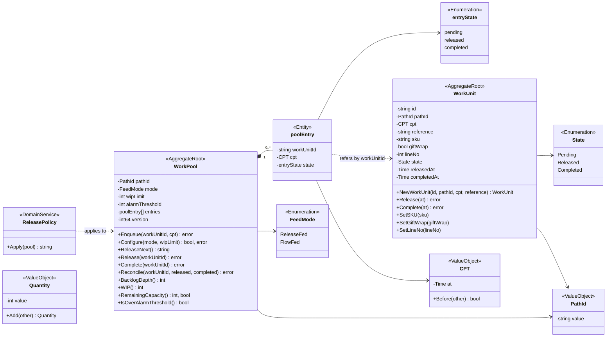
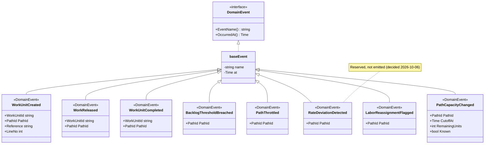
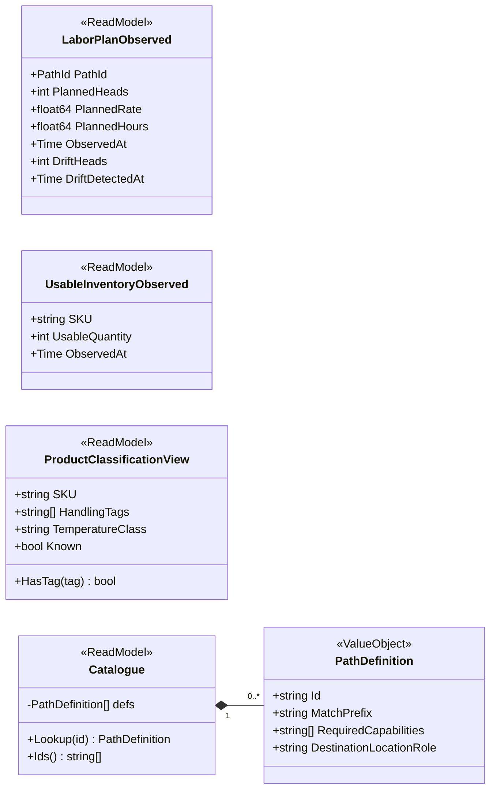
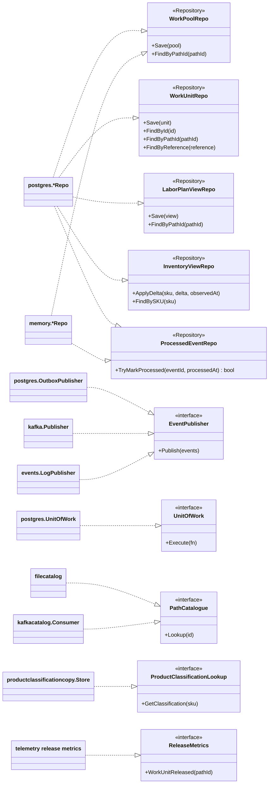
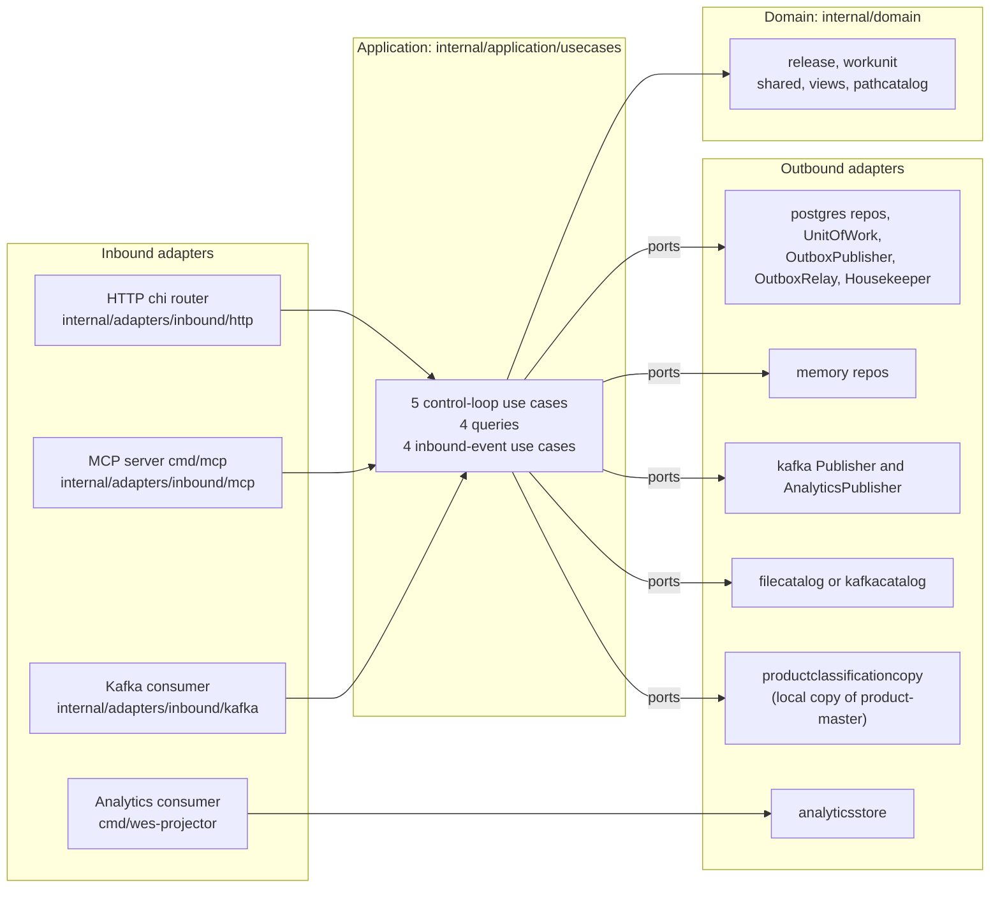

# UML class diagrams

Four diagrams, split so none exceeds about twenty classes: the aggregates and
value objects, the domain events, the read models, and the hexagon of ports
and adapters. Type and member names are the real Go identifiers; Go has no
visibility keyword for fields, so unexported fields are shown with `-` and
exported methods with `+`.

Stereotypes: `<<AggregateRoot>>`, `<<Entity>>`, `<<ValueObject>>`,
`<<Enumeration>>`, `<<DomainService>>`, `<<DomainEvent>>`, `<<ReadModel>>`,
`<<Repository>>` (an outbound port).

## 1. Aggregates and value objects

Source: `internal/domain/release/work_pool.go`,
`internal/domain/release/release_policy.go`, `internal/domain/workunit/work_unit.go`,
`internal/domain/shared/*.go`. Omits: read-only accessors (`PathId()`,
`Mode()`, `Entries()`, ...), `RestoreEntry` / `SetVersion` (repository
rehydration only), and the associations of
`Quantity`. `releasedAt` / `completedAt` are `*time.Time` (nil until the
transition). The `ChargeForecast` and `ShiftPlan`/`PathPlan` aggregates moved
to warehouse-planning
([ADR-0049](../adr/0049-charge-forecast-and-shift-plan-move-to-warehouse-planning.md)).

The association between `WorkPool` and `WorkUnit` is **by identity only**:
the pool's entries hold a work unit id, never a `WorkUnit`. They are two
aggregates with two consistency boundaries.

## 2. Domain events

Source: `internal/domain/shared/events.go`. Go has no inheritance: each event
**embeds** `baseEvent`, which is drawn as generalisation. Omits: the `New...`
constructors. `ChargeForecastReceived`, `ShiftPlanCommitted` and
`PathPlanDriftDetected` are retired
([ADR-0049](../adr/0049-charge-forecast-and-shift-plan-move-to-warehouse-planning.md)).

## 3. Read models and catalogue views

Source: `internal/domain/laborview/*.go`, `internal/domain/inventoryview/usable_inventory_observed.go`,
`internal/domain/productclassificationview/product_classification_view.go`,
`internal/domain/pathcatalog/path_definition.go`. `DriftHeads` and
`DriftDetectedAt` are pointers and deprecated: no longer computed since
ADR-0049, they only read back a drift recorded before it. Omits:
`pathcatalog.ErrUnknownPath`, returned by `Lookup` on no prefix match.

## 4. Ports and adapters

The application layer owns the ports (`internal/application/ports`); adapters
implement them and `cmd/wes/main.go` wires one adapter per port.

Source: `internal/application/ports/*.go`, `internal/adapters/**`,
`cmd/wes/main.go`, `cmd/mcp/main.go`, `cmd/wes-projector/main.go`,
`cmd/wes-reports/main.go`. Omits: `Clock` (`system.Clock`), the
`ProcessedEventReleaser` optional port, and `cmd/wes-reports` (serves
`GET /reports/throughput` from `analyticsstore.PostgresReport`). The MCP
server calls the use cases in-process through its own composition root,
not over REST.
