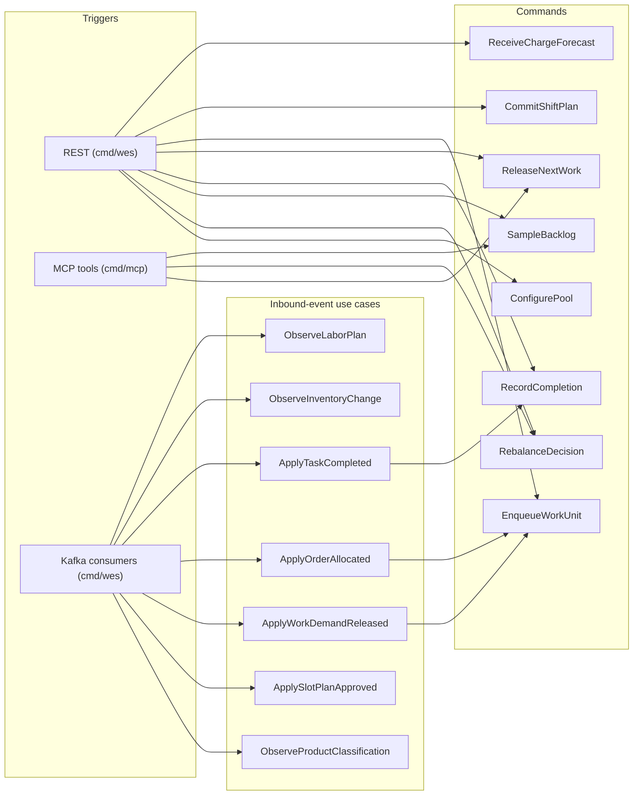

# Application use cases

`internal/application/usecases` holds one struct per use case. Each is wired
in a composition root (`cmd/wes/handlers.go`, `cmd/wes/serving.go`,
`cmd/mcp/main.go`) and runs its saves and publishes inside one
`UnitOfWork` — the outbox rows commit with the
state change ([ADR-0014](../adr/0014-transactional-outbox.md)). Unit tests that
use the in-memory doubles run the same steps back to back.

Source: `cmd/wes/handlers.go`, `cmd/wes/serving.go`, `cmd/mcp/main.go`,
`internal/application/usecases/*.go`.

## Commands

### ReceiveChargeForecast

- **Trigger**: `POST /paths/{pathId}/charge` → `201`.
- **Inputs**: `pathId`; `buckets[]` of `{cpt, quantity}`.
- **Invariants**: `pathId` is declared in the process-path catalogue
  (`400 unknown-path-id`); every bucket has both fields
  (`400 malformed-request-body`); at least one bucket
  (`charge-forecast-requires-buckets`); quantity is not negative
  (`invalid-quantity`).
- **State**: one `ChargeForecast` per path, replaced on every call (upsert on
  `path_id`).
- **Events**: `ChargeForecastReceived`.

### CommitShiftPlan

- **Trigger**: `POST /paths/{pathId}/plan` → `201`.
- **Inputs**: `plannedHeads`, `installedStations` (required), `rateUnitsPerHour`,
  `hours`, optional `fromLocationCode` + `toLocationCode`.
- **Invariants**: catalogue; `plannedHeads <= installedStations`
  (`heads-exceed-installed-stations`); counts within 0..2147483647; rate and
  hours positive; planned throughput finite.
- **Enrichment**: when both location codes are given and
  `TRAVEL_DISTANCE_MODE=http`, one facility-layout lookup stamps
  `travelDistanceM`/`travelDistanceEstimated`; any failure is fail-open
  ([ADR-0017](../adr/0017-travel-distance-lookup-on-commit-shift-plan.md)).
- **Reconciliation**: if Workforce's `LaborPlanObserved` exists for the path,
  the head counts are compared and the outcome stored on the view
  ([ADR-0019](../adr/0019-labor-plan-committed-shift-plan-reconciliation.md)).
- **Events**: `ShiftPlanCommitted`; `PathPlanDriftDetected` when the heads
  disagree.

### EnqueueWorkUnit

- **Trigger**: `POST /paths/{pathId}/work-units` → `201` (behind the
  `Idempotency-Key` middleware when Postgres is configured,
  [ADR-0022](../adr/0022-idempotency-key-middleware.md)); internally by
  `ApplyOrderAllocated` and `ApplyWorkDemandReleased`.
- **Inputs**: `workUnitId`, `cpt`, `reference` (required); `sku`, `giftWrap`,
  `lineNo` (optional); transfer fields `transferRef`, `workKind`, `siteId`,
  `quantity` only via `WorkDemandReleased`.
- **Invariants**: catalogue (REST handler); non-empty id and reference;
  `lineNo` in 1..2147483647 when given; the id is not already in the path's
  pool (`409 work-unit-already-enqueued`). The first enqueue on a path
  creates its `WorkPool` as `ReleaseFed` with WIP limit and alarm threshold
  1000. The pool save is retried on optimistic-concurrency conflicts
  (12 attempts, [ADR-0029](../adr/0029-work-pool-optimistic-concurrency.md)).
- **Events**: `WorkUnitCreated`.

### ReleaseNextWork

- **Trigger**: `POST /paths/{pathId}/work-releases` → `200`; MCP tool
  `release_next_work`.
- **Inputs**: `pathId`.
- **Invariants**: the pool exists (`404`); it has a pending entry
  (`409 work-pool-empty`); a `ReleaseFed` pool is below its WIP limit
  (`409 wip-limit-reached`); the earliest CPT goes first (insertion order
  breaks ties); each entry is released at most once. A pending entry whose
  work unit already moved on (left by a pre-versioning lost update) is healed
  and skipped, and so is a leftover entry of a `Cancelled` RELOCATE unit
  ([ADR-0040](../adr/0040-slot-plan-relocation-work.md)). Optimistic retry as above.
- **Events**: `WorkReleased` (the integration publisher enriches it with CPT,
  reference, `gift_wrap`, `line_no`, transfer fields, the RELOCATE
  `relocation` object and — from the classification copy —
  `required_capabilities`/`fragile`). Also increments
  `wes.work_units.released`.

### RecordCompletion

- **Trigger**: `POST /work-units/{id}/completions` → `200`; internally by
  `ApplyTaskCompleted`.
- **Inputs**: work-unit id.
- **Invariants**: the unit exists (`404`), was released
  (`work-unit-not-released`) and is not already completed
  (`work-unit-already-completed`). Its pool entry is reconciled to completed,
  which frees the WIP slot; a path with no pool or a pool that never held the
  unit is not an error. Completing a RELOCATE unit also admits, in the same
  atomic scope, every Pending RELOCATE unit blocked by it (`blocked_by` is
  cleared and the unit enters the RELOCATE pool), so a fill never runs
  before the vacate of its slot ([ADR-0040](../adr/0040-slot-plan-relocation-work.md)).
- **Events**: `WorkUnitCompleted`.

### SampleBacklog

- **Trigger**: `GET /paths/{pathId}/telemetry[?cutoffAt=<RFC3339>]` → `200`;
  MCP tool `get_backlog_telemetry`; MCP resource `telemetry://{pathId}/backlog`.
- **Inputs**: `pathId`; optional `cutoffAt` (REST only).
- **Output**: `backlogDepth` (pending), `wip` (released, not completed), `mode`,
  `overAlarmThreshold`; with `cutoffAt` also `remainingCapacityKnown` and
  `remainingCapacityUnits` (WIP limit minus WIP; unknown for `FlowFed`).
- **Invariants**: the pool exists (`404`); a present-but-empty or malformed
  `cutoffAt` is `400`.
- **Events**: `BacklogThresholdBreached` whenever the backlog exceeds the
  alarm threshold (so this read publishes — including through the MCP tool
  and resource; the tool is therefore annotated non-read-only, destructive,
  [ADR-0037](../adr/0037-mcp-annotations-for-event-raising-tools.md));
  `PathCapacityChanged` when `cutoffAt` is supplied
  ([ADR-0018](../adr/0018-path-capacity-changed.md)).

### RebalanceDecision

- **Trigger**: `GET /paths/{pathId}/rebalance` → `200`; MCP tool
  `get_rebalance_recommendation`.
- **Output**: `NoActionNeeded`, `ThrottleUpstream` (a `FlowFed` pool over its
  alarm threshold) or `ReassignLabor` (a `ReleaseFed` pool at its WIP limit
  with backlog waiting) ([ADR-0003](../adr/0003-flow-balancing-as-domain-service.md)).
- **Events**: `PathThrottled` with `ThrottleUpstream`;
  `LaborReassignmentFlagged` with `ReassignLabor` (so the MCP tool is
  annotated non-read-only, destructive,
  [ADR-0037](../adr/0037-mcp-annotations-for-event-raising-tools.md)).

### ConfigurePool

- **Trigger**: `PUT /paths/{pathId}/pool` → `200`.
- **Inputs**: `mode` (`ReleaseFed` or `FlowFed`), `wipLimit` (required).
- **Invariants**: catalogue; known mode (`unknown-feed-mode`); `wipLimit > 0`
  (`invalid-wip-limit`). Creates the pool when missing. Lowering the limit
  below current WIP evicts nothing; an identical repeat writes nothing
  ([ADR-0034](../adr/0034-configure-pool-command.md)). It is the only way to
  get a `FlowFed` pool.
- **Events**: none.

## Queries

| Use case | Trigger | Returns | Not found |
|---|---|---|---|
| `GetWorkUnit` | `GET /work-units/{id}` | one work unit (`id`, `pathId`, `cpt`, `reference`, `state`, `giftWrap`, `sku`, `lineNo`, `releasedAt`, `completedAt`, `cancelledAt`; RELOCATE units add `relocation` = `planId`, `moveSeq`, `kind`, `siteId`, `fromSlot`, `toSlot`, `blockedBy`) | `404` |
| `GetWorkUnitsByReference` | `GET /work-units?reference=` | every work unit with that reference, keyset-paged (`{items,nextCursor}`; `items` empty when none) | `400 reference-required` when the parameter is missing |
| `LaborPlanView` | `GET /paths/{pathId}/labor-plan-view` | the `LaborPlanObserved` projection, with the ADR-0019 drift outcome | `404` until a `ShiftPlanCommitted` for the path arrives |
| `InventoryView` | `GET /inventory-view/{sku}` | the `UsableInventoryObserved` projection | `404` until an inventory event for the SKU arrives |

## Inbound-event use cases

All seven claim the CloudEvents `id` in `processed_events` inside the **same**
atomic scope as their effect (`onceAtomically`,
[ADR-0028](../adr/0028-processed-event-mark-atomic-with-handling.md)): a
redelivery is a no-op, and a failure rolls the mark back so the retry
re-applies the event. The consumer that calls them is described on
[Integration events](../ecosystem/integration-events.md).

| Use case | Event (topic) | Effect | Invariants / failure | Events raised |
|---|---|---|---|---|
| `ObserveLaborPlan` | `ShiftPlanCommitted` (`warehouse.workforce.events`) | upserts `LaborPlanObserved` for `path_id`; compares with our committed `PathPlan` if one exists | the adapter rejects a `path_id` outside the catalogue (retried, then DLQ) | `PathPlanDriftDetected` when heads disagree |
| `ObserveInventoryChange` | `StockReserved` / `ReservationRevoked` (`warehouse.inventory.events`) | applies `-quantity` / `+quantity` to `UsableInventoryObserved` for the SKU | — | none |
| `ApplyTaskCompleted` | `TaskCompleted` (`warehouse.fulfillment.events`) | runs `RecordCompletion` for `work_unit_id` | an unknown work unit is a logged skip (still marked processed); any other error is retried, then DLQ | `WorkUnitCompleted` (via `RecordCompletion`) |
| `ApplyOrderAllocated` | `OrderAllocated` / `OrderPartiallyAllocated` (`warehouse.order-management.events`) | one `EnqueueWorkUnit` per line: id `{order_id}-line-{line_no}`, CPT = `promise_date`, reference = `order_id`, plus `sku`, `gift_wrap`, `line_no` ([ADR-0031](../adr/0031-order-allocated-choreography.md), [ADR-0036](../adr/0036-work-unit-line-no-on-work-released.md)) | every line's `path_id` checked against the catalogue before anything is enqueued; an out-of-range `line_no` is stored as unknown; a line already in the pool is skipped | `WorkUnitCreated` per new line |
| `ApplyWorkDemandReleased` | `WorkDemandReleased` (`warehouse.network-inventory-planning.events`) | one `EnqueueWorkUnit` with id = reference = `demand_id`, CPT = `cpt`, and the transfer fields ([ADR-0033](../adr/0033-transfer-work-demand-choreography.md)) | `work_kind` must be `TRANSFER_PICK`, `TRANSFER_DISPATCH` or `TRANSFER_ARRIVAL`; `path_id` in the catalogue; an existing `demand_id` is a no-op | `WorkUnitCreated` |
| `ApplySlotPlanApproved` | `SlotPlanApproved` (`warehouse.slotting-optimization.events`) | one RELOCATE unit per move: id `{plan_id}-move-{seq}` (seq = 0-based position in `moves`), reference = `plan_id`, CPT = `approved_at` + `RELOCATION_CPT_HORIZON`, path `RELOCATE`. A move into a slot another move of the plan vacates gets `blocked_by` and stays out of the pool until that unit completes (swap cycles broken at the lowest seq). A newer plan for the site cancels the other plans' **Pending** units (state `Cancelled`, pool entry withdrawn); released work runs to completion ([ADR-0040](../adr/0040-slot-plan-relocation-work.md)) | move `kind` must be `Relocate`, `Assign` or `Vacate` with the slots that kind needs; `RELOCATE` must be in the catalogue and, when it declares an intake, admit `SLOT_RELOCATION` (process-path-management ADR 0034); all retried, then DLQ. An older plan than the site's latest, or the same plan again, is a no-op | `WorkUnitCreated` per planned unit |
| `ObserveProductClassification` | `ProductClassified` (`warehouse.product-master.events`) | version-guarded upsert into `product_classification_copy` ([ADR-0035](../adr/0035-product-classification-local-copy.md)) | an older or equal version is a stale no-op (id still recorded) | none |

## Events no use case raises

`RateDeviationDetected` has a constructor in
`internal/domain/shared/events.go`, an outbound encoding and a column in the
analytics `throughput_rollup`, but no production use case creates it, so the
report's `rateDeviationDetected` count stays 0.

## Not use cases

- The process-path catalogue (`filecatalog`, `kafkacatalog`) is an outbound
  adapter behind `ports.PathCatalogue`, read by the handlers and the
  inbound-event use cases.
- The analytics projection (`internal/analytics/report`,
  `internal/adapters/outbound/analyticsstore`) is driven directly by the
  projector's consumer and read by the reports handlers — it bypasses this
  package by design ([ADR-0011](../adr/0011-analytical-data-product.md)).
