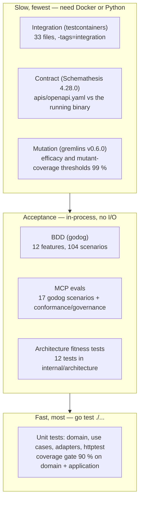

# Testing

Every layer below is a real suite in this repository; counts were taken on
`develop` (the BDD wave of PR #165 is already merged there).



Source: `Makefile`, `.github/workflows/ci.yml`, `.gremlins.yaml`,
`features/*.feature`, `internal/architecture/*_test.go`.

## Make targets

| Target | Runs | Needs |
|---|---|---|
| `make test` | `go test ./... -race` — unit, httptest, the BDD suite and the MCP evals | Go only |
| `make coverage` | the same with `-coverprofile=coverage.out -coverpkg=./internal/domain/...,./internal/application/...`, failing below **90 %** | Go |
| `make bdd` | `go test ./... -run TestFeatures -v` | Go |
| `make arch-test` | `go test ./internal/architecture/... -v` | Go |
| `make integration` | `go test -tags=integration ./... -race -count=1` | Docker (testcontainers starts Postgres and Kafka) |
| `make contract` | `scripts/contract-test.sh` | `st` (`pip install 'schemathesis==4.28.0'`) |
| `make mutation` | `gremlins unleash ./internal/domain/release` (the blocking subset) | gremlins v0.6.0 |
| `make mutation-all` | `gremlins unleash ./internal/domain` (slow) | gremlins |
| `make vuln` | `govulncheck ./...` | govulncheck |
| `make lint` | `golangci-lint run ./...` (pinned v2.13.1) | golangci-lint |
| `make check` | `fmt-check vet build lint test` | Go + golangci-lint |
| `make check-all` | `check` + `coverage arch-test bdd` | same |
| `make check-fast` | `fmt-check vet arch-test` + tests of the packages changed vs `HEAD` (agent Stop hook) | Go, Python |
| `make guide-lint` / `make harness-test` | `scripts/harness/guide_lint.py` / `scripts/harness/test_hook.py` | Python 3 |

Git hooks (`lefthook.yml`, after `lefthook install`): **pre-commit** runs
`make fmt-check`, `make vet` and `make lint`; **pre-push** runs `make check`.
Neither needs a database.

## Unit tests

131 `_test.go` files. The domain (`internal/domain/**`) and use cases
(`internal/application/usecases`) carry most of them because they have no I/O
to fake; in-memory adapters (`internal/adapters/outbound/memory`) stand in for
repositories. The inbound HTTP adapter is tested with `httptest` (status
mapping, problem types, idempotency errors, logging, otelchi telemetry), the
Kafka adapters with fake readers/writers (retry-then-DLQ decisions, DLQ
auto-create, CloudEvents golden files under
`internal/adapters/outbound/kafka/testdata/ce_*.golden.json`), and the
composition roots in `cmd/wes` and `cmd/mcp` (classification wiring, shutdown
order, housekeeper wiring).

The CI `test` job enforces the **90 %** coverage gate on
`./internal/domain/...` and `./internal/application/...` only.

## BDD acceptance (godog)

`features_test.go` / `features_wave2_test.go` define `TestFeatures`, which
runs every file under `features/` with `Strict: true` (an undefined or
pending step fails) against the real use cases wired to in-memory adapters.

| Feature file | Scenario headings | Executed scenarios |
|---|---|---|
| `charge_forecast.feature` | 3 | 3 |
| `completion_telemetry.feature` | 2 | 2 |
| `consumed_events.feature` | 15 | 17 |
| `labor_plan_reconciliation.feature` | 4 | 4 |
| `pool_configuration.feature` | 15 | 17 |
| `read_model_views.feature` | 8 | 8 |
| `rebalance.feature` | 2 | 2 |
| `request_validation_and_probes.feature` | 14 | 28 |
| `shift_plan.feature` | 2 | 2 |
| `work_pool_capacity.feature` | 2 | 2 |
| `work_release.feature` | 2 | 2 |
| `work_unit_enqueue.feature` | 12 | 17 |
| **12 files** | **81** | **104** (581 steps) |

"Executed" counts Scenario Outline example rows; the totals are godog's own
summary from `go test . -run TestFeatures -count=1 -v`:
`104 scenarios (104 passed)`, `581 steps (581 passed)`.

## MCP evals

`internal/adapters/inbound/mcp` has its own godog suite,
`TestMCPEvalSuite`, over `testdata/features/mcp_tools.feature`
(17 scenarios, 82 steps, all passing), plus:

- `TestEvalConformance_*` — protocol behaviour over a real client session:
  initialize handshake, unknown tool / wrong-typed / extra arguments rejected,
  resource-template discovery, unknown resource and prompt rejected, prompt
  listable, closed session ends calls;
- `TestEval_*` governance checks — input schemas resolve and constrain,
  every parameter is described, the tool registry matches
  `testdata/tool_registry.golden` (name, read-only, destructive), tool names
  are unique across the fleet snapshot `testdata/fleet_tool_snapshot.golden`,
  and the report tool is registered only when a reports client exists.

CI runs them in the `evals-tests` job.

## Integration tests (testcontainers)

33 files behind `//go:build integration`. Each test boots its own Postgres
(`testcontainers-go/modules/postgres`) and/or Kafka
(`testcontainers-go/modules/kafka`); nothing reads `DATABASE_URL` or
`KAFKA_BROKERS` from the environment, which the fitness tests enforce. They
cover the Postgres repositories and migrations (including the
`0001`–`0014` chain, pool limits and `statement_timeout`, optimistic
concurrency on `work_pools`, gift-wrap / line-no / transfer / relocation
columns and `slot_plans`), the
outbox and its lag gauge, the housekeeper, the idempotency middleware, the
Kafka consumer (atomic processed mark, DLQ and DLQ auto-create,
`WorkDemandReleased`), partition affinity of the `Hash` balancer, the Kafka
catalogue replay, the classification copy, the analytics store, OTel pgx
tracing, the MCP Streamable HTTP transport, `cmd/mcp` and `cmd/wes`
classification wiring, and use-case wiring end to end.

```sh
make integration            # all of them, -race -count=1
go test -tags=integration ./internal/adapters/outbound/postgres/... -run Outbox -v
```

## Contract tests (Schemathesis)

`scripts/contract-test.sh` builds `cmd/wes`, writes a throw-away
`sortable-fc` catalogue (`pick`, `pack`, `rebin`, `slam` prefixes), boots the
service **in memory** on `127.0.0.1:18086` (`CONTRACT_PORT`), waits for
`/healthz`, then runs
`st run apis/openapi.yaml --max-examples 100 --workers 4 --exclude-operation-id commitShiftPlan`
(`CONTRACT_MAX_EXAMPLES` overrides 100). `commitShiftPlan` is excluded because
its `plannedHeads <= installedStations` invariant cannot be expressed in
OpenAPI 3.0.3; it is covered by BDD and unit tests instead. The
`/reports/*` routes of `cmd/wes-reports` are specified separately in
`apis/openapi-reports.yaml` ([ADR-0038](../adr/0038-reports-api-openapi-contract.md))
and contract-tested in Go, without Schemathesis or a database:
`TestReportsContract_RoutesMatchSpec` (the router's routes, walked with
`chi.Walk`, equal the spec's paths) and `TestReportsContract_ResponsesMatchSpec`
(every documented status of every operation, driven through the real router
with a fake store; each body has every required property and no
undocumented one) in `internal/adapters/inbound/http/reports_contract_test.go`.

## Mutation testing (gremlins)

`.gremlins.yaml` pins `workers: 1`, `timeout-coefficient: 30` and the
thresholds **`efficacy: 99`** and **`mutant-coverage: 99`**. gremlins fails
when the measured value is at or below the threshold, so 99 locks in the
current 100 % and fails on the first surviving mutant. Last recorded
measurements in that file: `./internal/domain/release` 36/36 killed,
`./internal/domain` 73/73 killed.

## Architecture fitness tests

`internal/architecture` (run by `make arch-test` and the `arch-test` job):

| Test | Rule |
|---|---|
| `TestHexagonalDependencyRule` | domain depends on nothing; application only on domain; inbound and outbound adapters never on each other; only `cmd/` wires every layer ([ADR-0007](../adr/0007-arch-go-fitness-tests.md)) |
| `TestApplicationPortsContainOnlyInterfaces` | `internal/application/ports` holds interfaces only |
| `TestMCPAdapterDependencyRule` | the MCP adapter depends only on application/domain, and nothing depends on it ([ADR-0008](../adr/0008-mcp-inbound-adapter.md)) |
| `TestNoAuthMiddlewareReintroduced` | no bearer/JWT middleware in the inbound adapters ([ADR-0016](../adr/0016-remove-rest-mcp-static-bearer-auth.md)) |
| `TestKafkaConsumerGroupNeverHardcodedInline` | consumer group ids come from config/constants, never inline literals |
| `TestKafkaIntegrationTestsUseTestcontainers` / `TestPostgresIntegrationTestsUseTestcontainers` (+ `TestPostgresIntegrationSensorFailsOnBadFixtures`) | integration tests start their own containers; no env-gated skips, no hard-coded `localhost:9092` |
| `TestCloudEventsOnly` | CloudEvents is the only envelope; no envelope-mode toggle ([ADR-0027](../adr/0027-cloudevents-mandatory-event-envelope.md)) |
| `TestReplayConsumersSetCommitInterval` | a process-unique replay consumer must set `CommitInterval` |
| `TestKafkaWritersSetRequiredAcks`, `TestKafkaWriterAcksSensorBites` | every kafka-go `Writer{...}` literal in a non-test file under `internal/` or `cmd/` sets `RequiredAcks` (kafka-go defaults to `RequireNone`, acks=0, which silently drops messages on a broker blip); the sensor is proven to fail |
| `TestEventCatalogueMatchesContract` (+ `TestEventCatalogueDetector`) | every own CloudEvents type in `apis/asyncapi.yaml` appears in a CloudEvents ADR |

`violation_test.go` holds the fixtures that prove the detectors can fail.

## Other suites

- **Frontend** (`web/`): the `web` CI job runs `npm run lint`, `npx tsc -b`,
  `npm test` (Vitest) and `npm run build`.
- **Helm chart**: `python3 charts/wes-work-planning/tests/test_service_selectors.py`
  proves each Service selects exactly one Deployment. It is **not** run by
  `ci.yml`; `helm-lint` (chart-testing `ct lint`) runs only on PRs into `main`.
- **Agent harness**: `guide-lint` job runs `guide_lint.py`, `repo_lint.py`,
  `test_hook.py` and `test_repo_lint.py`.

## CI jobs (`.github/workflows/ci.yml`)

Triggers: push and pull request on `main` and `develop`, a weekly schedule
(Monday 06:00 UTC) and manual dispatch.

| Job | Runs | When |
|---|---|---|
| `lint` | golangci-lint v2.13.1 | every push/PR |
| `guide-lint` | the four harness scripts above | every push/PR |
| `complexity` | golangci-lint `--enable-only gocyclo,gocognit,cyclop,funlen,nestif` + informational gocyclo report (over 10; gate 15) | every push/PR |
| `test` | `go build`, `go vet`, `go test ./... -race` with coverage, 90 % gate | every push/PR |
| `bdd` | `go test ./... -run TestFeatures -v` | every push/PR |
| `contract` | `scripts/contract-test.sh` with Schemathesis 4.28.0 | every push/PR |
| `evals-tests` | `go test ./internal/adapters/inbound/mcp/... -race -run '^TestEval\|^TestMCPEvalSuite' -v` | every push/PR |
| `integration` | `go test -tags=integration ./... -race -count=1` | every push/PR |
| `mutation-fast` | `gremlins unleash ./internal/domain/release` | every push/PR |
| `vuln` | govulncheck v1.8.0 | every push/PR |
| `api-lint` | Spectral on `apis/openapi.yaml` and `apis/asyncapi.yaml`, `--fail-severity=warn` | every push/PR |
| `arch-test` | `go test ./internal/architecture/... -v` | every push/PR |
| `docs-api-drift` | in `docs/`: `npm ci`, `clean-api-docs wes` + `gen-api-docs wes`, fail on any diff under `docs/api/rest` | every push/PR |
| `web` | lint, typecheck, Vitest, build of `web/` | every push/PR |
| `mutation` | `gremlins unleash ./internal/domain`; opens/closes a red issue | schedule / dispatch only |
| `drift` | `deadcode`, `go mod tidy -diff`, knip on `web/`, coverage-quality report; opens/closes a red issue | schedule / dispatch only |
| `helm-lint` | `ct lint` on the chart | PRs into `main` only |
| `trivy-scan` | image build + Trivy (SARIF upload and a blocking table scan) | PRs into `main` only |
| `docker-publish` | build, push to `ghcr.io/iqvo/wes-work-planning`, cosign sign, SBOM attest | push to `main`, after every blocking job |
| `release` | next `v*` tag, image re-tag, Helm chart package, GitHub release | push to `main`, after `docker-publish` |

The docs site itself is built by `.github/workflows/docs.yml`, which runs only
on pushes to `main` (and dispatch) — a pull request never builds the site, so
run `npm run build` in `docs/` locally before merging docs changes.
