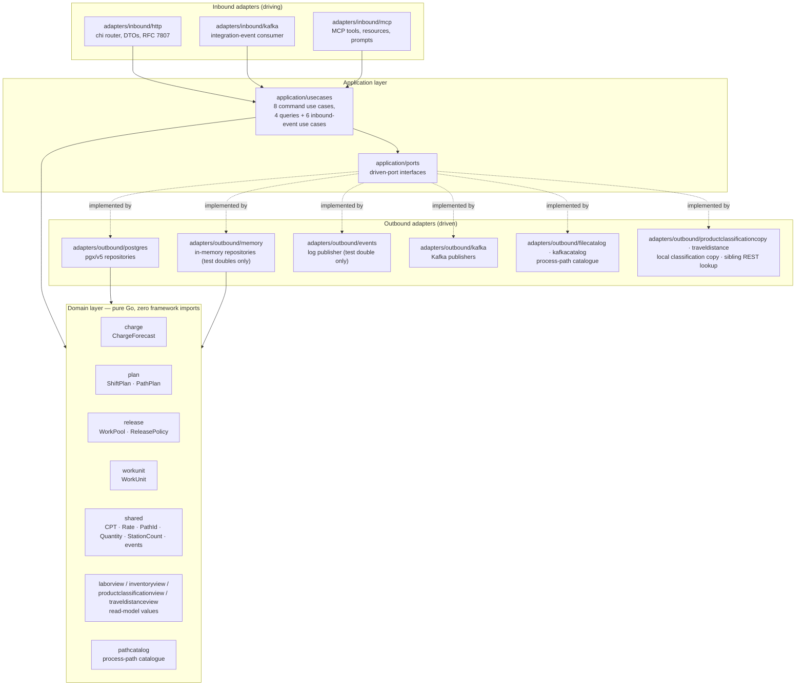
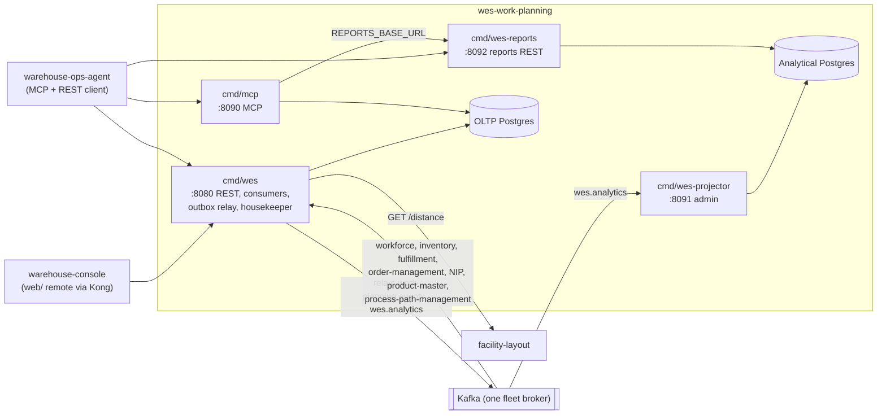

# Architecture — hexagonal layering and runtime view

The repository is organised strictly as **ports & adapters**. The dependency
rule is non-negotiable and *executable* — it is asserted by architecture
fitness tests in CI, not just documented ([ADR-0007](../adr/0007-arch-go-fitness-tests.md)).

> **domain** depends on nothing · **application** depends on domain ·
> **adapters** depend on application and domain · only `cmd/` wires everything



Source: `internal/architecture/architecture_test.go` (the enforced rule) and
the package tree under `internal/`.

## Runtime view: binaries, ports and data stores

The layers above are compiled into **four binaries** (all in one image, see
`Dockerfile`), each its own composition root under `cmd/`:

| Binary | Role | Listens on | Inbound adapters | Outbound adapters / stores |
|---|---|---|---|---|
| `cmd/wes` | the OLTP service: every REST endpoint, all Kafka consumers, the outbox relay and the housekeeper | `HTTP_ADDR` `:8080` — REST, `/healthz`, `/readyz` | `inbound/http`, `inbound/kafka` (integration consumer on 5 topics, `ProductClassified` consumer), `outbound/kafkacatalog` (catalogue replay) | OLTP Postgres (or memory), Kafka publishers + relay, facility-layout REST, file catalogue |
| `cmd/mcp` | MCP server over the same use cases ([ADR-0008](../adr/0008-mcp-inbound-adapter.md)) | `MCP_ADDR` `:8090` — MCP at `/` and `/mcp`, `/healthz` | `inbound/mcp` | the same OLTP Postgres (read/write, no migrations), Kafka publishers or outbox rows, reports REST client |
| `cmd/wes-projector` | analytics **writer** ([ADR-0011](../adr/0011-analytical-data-product.md)) | `ADMIN_ADDR` `:8091` — `/healthz` only | analytics consumer on `warehouse.wes.analytics` | analytical Postgres (owns and migrates it) |
| `cmd/wes-reports` | analytics **reader** | `HTTP_ADDR` `:8092` — `/reports/throughput`, `/reports/throughput/freshness`, `/healthz` | `inbound/http` reports router | analytical Postgres, read-only pool |



Source: `cmd/wes/serving.go`, `cmd/wes/publisher.go`, `cmd/mcp/main.go`,
`cmd/wes-projector/main.go`, `cmd/wes-reports/main.go`,
`charts/wes-work-planning/values.yaml`.

**Data stores.**

- **OLTP Postgres** (`DATABASE_URL`, migrated by `cmd/wes` from `migrations/`):
  `charge_forecasts`, `shift_plans`, `work_pools` (+ `version`),
  `work_pool_entries`, `work_units`, `processed_events`, `labor_plan_view`,
  `usable_inventory_view`, `outbox_events`, `idempotency_keys`,
  `product_classification_copy` (and an unused `events` table from
  `0001_init`). `DATABASE_URL` is mandatory for both `cmd/wes` and `cmd/mcp`
  ([ADR-0044](../adr/0044-postgres-and-kafka-are-the-only-runtime.md)); they
  share this one database.
- **Analytical Postgres** (`ANALYTICS_DATABASE_URL`, a separate database
  migrated by the projector from `migrations/analytics/`):
  `analytics_processed_events`, `analytics_consumed_events`,
  `throughput_rollup`, plus `schema_migrations_analytics`.
- **Kafka**: publishes `warehouse.work-planning.events` and
  `warehouse.wes.analytics`; consumes the topics listed on
  [Integration events](../ecosystem/integration-events.md).

Deployment, ports and probes: [Runbook](../operations/runbook.md);
every variable: [Configuration](../operations/configuration.md).

## Package map

```
cmd/wes/                        OLTP composition root — the only place every layer meets
cmd/wes-projector/              analytics writer (ADR-0011)
cmd/wes-reports/                analytics read-only reports API (ADR-0011)
cmd/mcp/                        MCP server (ADR-0008)
internal/
  domain/                       pure Go: aggregates, value objects, events, errors
    charge/                     ChargeForecast aggregate
    plan/                       ShiftPlan + PathPlan aggregates
    release/                    WorkPool aggregate + ReleasePolicy domain service
    workunit/                   WorkUnit aggregate
    shared/                     CPT, Rate, PathId, Quantity, StationCount, DomainEvent
    laborview/                  LaborPlanObserved read-model value
    inventoryview/              UsableInventoryObserved read-model value
    pathcatalog/                process-path catalogue + prefix lookup (ADR-0012)
    productclassificationview/  SKU classification read-model value (ADR-0009, ADR-0035)
    traveldistanceview/         travel-distance read-model value (ADR-0017)
  analytics/report/             analytics report model (ADR-0011)
  application/
    ports/                      driven-port interfaces (repos, publisher, clock)
    usecases/                   one struct per use case
  adapters/
    inbound/http/               chi router, DTOs, domain-error → HTTP mapping
    inbound/kafka/              integration-event consumer (5 topics), ProductClassified consumer (ADR-0035) + analytics consumer
    inbound/mcp/                MCP tools, resources, prompts (ADR-0008)
    outbound/postgres/          pgxpool repositories, UnitOfWork, outbox + relay (ADR-0014)
    outbound/memory/            thread-safe in-memory repositories (test doubles only)
    outbound/events/            log EventPublisher + MultiPublisher (test doubles only)
    outbound/system/            production wall clock (ports.Clock)
    outbound/kafka/             integration + analytics publishers, outbox encoders, RelaySink
    outbound/filecatalog/       process-path catalogue from YAML (PATH_CATALOGUE_SOURCE=file)
    outbound/kafkacatalog/      process-path catalogue from Kafka (PATH_CATALOGUE_SOURCE=kafka)
    outbound/productclassificationcopy/  local copy of product-master's classification (ADR-0035)
    outbound/traveldistance/    facility-layout REST lookup
    outbound/analyticsstore/    analytics Postgres store
    outbound/telemetry/         OpenTelemetry setup
    kafka/cloudevents/          CloudEvents 1.0 envelope helpers (New/Decode), topics, consumed types
  architecture/                 arch-go fitness tests
migrations/                     golang-migrate SQL files (analytics/ for the projector)
apis/                           openapi.yaml + asyncapi.yaml (the published contracts)
features/                       godog (Gherkin) acceptance specs
```

## The driven ports

Every outbound dependency is an interface owned by the **application** layer,
so the domain never learns that Postgres or Kafka exist:

| Port | Purpose |
|---|---|
| `ChargeRepo` | persist/retrieve `ChargeForecast`, one per path |
| `PlanRepo` | persist/retrieve `ShiftPlan`, one per path |
| `WorkPoolRepo` | persist/retrieve `WorkPool`, one per path |
| `WorkUnitRepo` | persist/retrieve `WorkUnit` by id and by path |
| `EventPublisher` | publish domain events (the Kafka outbox encoders in production; a log/multi publisher in unit tests only) |
| `Clock` | abstract "now" so use cases and tests are deterministic |
| `LaborPlanViewRepo` | persist the `LaborPlanObserved` projection, one per path |
| `InventoryViewRepo` | atomically apply a delta to `UsableInventoryObserved`, keyed by SKU |
| `ProcessedEventRepo` | record consumed CloudEvents `id`s so redelivery is a no-op |
| `ProcessedEventReleaser` | optional: undo a non-transactional (in-memory test double) mark when the effect fails (ADR-0028) |
| `UnitOfWork` | run a use case's save + publish in one Postgres transaction (ADR-0014) |
| `ReleaseMetrics` | record the `wes.work_units.released` business counter (ADR-0013) |
| `PathCatalogue` | look up a `pathId` in the declared process-path catalogue (ADR-0012) |
| `ProductClassificationLookup` | read a SKU's classification from the local copy of product-master's events (ADR-0009, ADR-0035) |
| `ProductClassificationCopyRepo` | apply a `ProductClassified` to that copy, version-guarded (ADR-0035) |
| `TravelDistanceLookup` | read a travel distance from facility-layout (ADR-0017) |

The composition root wires Postgres (`DATABASE_URL`) and Kafka
(`KAFKA_BROKERS`) unconditionally ([ADR-0044](../adr/0044-postgres-and-kafka-are-the-only-runtime.md));
the only choices left in environment variables are file vs Kafka catalogue
(`PATH_CATALOGUE_SOURCE`) and the permissive vs HTTP travel-distance lookup
(`TRAVEL_DISTANCE_MODE`, a REST sync edge).

## Why this shape

The reason is not tidiness — it is that the interesting rules of this domain
(priority by CPT, at-most-once handout, WIP limits, `plannedHeads ≤
installedStations`) are *decisions*, and decisions belong somewhere with no
infrastructure in it, so they can be exercised exhaustively and cheaply. The
domain and application packages carry the bulk of the test suite precisely
because they have no I/O to mock. See
[ADR-0001](../adr/0001-hexagonal-ports-and-adapters.md).
