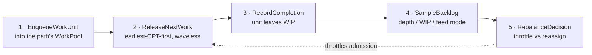

# What this service does

The bounded context is built around **five control-loop use cases**. They
form a single closed control loop: release → observe → correct. The shift's
plan (its charge forecast and its labour plan) is warehouse-planning's since
[ADR-0049](../adr/0049-charge-forecast-and-shift-plan-move-to-warehouse-planning.md):
`POST /paths/{pathId}/charge` and `/plan` answer `410` naming
`PUT /workload-forecasts/{site_id}/{path_id}` and
`PUT /labour-plans/{site_id}/{shift_id}/{path_id}` there.
Alongside them sit `ConfigurePool`, read-only queries (`GetWorkUnitsByReference`,
`GetWorkUnit`, `LaborPlanView`, `InventoryView`) and the ten inbound-event
use cases that apply other contexts' events (`ObserveLaborPlan`,
`ObserveInventoryChange`, `ApplyTaskCompleted`, `ObserveProductClassification`,
`ObservePackLevel`, and the five that plan or cancel work from upstream facts:
`ApplyOrderAllocated`, `ApplyWorkDemandReleased`, `ApplySlotPlanApproved`,
`ApplyReplenishmentRequested`, `ApplyReplenishmentCancelled`), each
idempotent via one atomic processed-event mark
([ADR-0028](../adr/0028-processed-event-mark-atomic-with-handling.md)).

`RebalanceDecision`'s "reassign labour" is a flag for people to act on; the
labour plan itself is warehouse-planning's.

## The five use cases

### 1. `EnqueueWorkUnit(path, cpt, ref)`

Creates a `WorkUnit` in state `Pending` carrying its CPT and an external
reference (e.g. the source order line), and enqueues it in that path's
`WorkPool`. Optional `sku` and `giftWrap` ride along for the `WorkReleased`
payload ([ADR-0009](../adr/0009-product-classification-propagation-to-work-released.md),
[ADR-0010](../adr/0010-gift-wrap-as-a-work-released-characteristic.md)).
The first enqueue on a path whose pool was never configured creates it as
release-fed with a WIP limit and alarm threshold of 1000
(`defaultWIPLimit`/`defaultAlarmThreshold`); an operator sets a path's mode and
WIP limit explicitly with `PUT /paths/{pathId}/pool`
([ADR-0034](../adr/0034-configure-pool-command.md)).
Over REST with Postgres the call requires an `Idempotency-Key` header
([ADR-0022](../adr/0022-idempotency-key-middleware.md)); order-management
reaches the same use case by event choreography
([ADR-0031](../adr/0031-order-allocated-choreography.md)).

### 2. `ReleaseNextWork(path)`

Applies the `ReleasePolicy` **domain service** to the path's `WorkPool`. The
pool hands out the pending entry with the **earliest CPT** — at most once —
and, on a *release-fed* pool, refuses when WIP is already at the pool's WIP
limit (`ErrWIPLimitReached`).

This is the waveless heart of the service: there is no wave, no batch window,
no schedule. Admission is a **policy applied continuously on demand**. See
[ADR-0002](../adr/0002-waveless-continuous-release.md).

Emits `WorkReleased`, the event `fulfillment-execution` consumes to create a
`Task`.

### 3. `RecordCompletion(workUnitId)`

Transitions a `Released` work unit to `Completed`. The aggregate rejects
double-completion (`ErrAlreadyCompleted`) and completion of a unit that was
never released (`ErrNotReleased`).

Reachable two ways: `POST /work-units/{id}/completions`, or a `TaskCompleted`
event consumed from `fulfillment-execution` through `ApplyTaskCompleted` —
the same use case, called from a different inbound adapter. Completion also
frees the unit's WIP slot on its `WorkPool` (the pool entry is reconciled to
`completed`), which is what lets the next release on a saturated
release-fed path proceed. Over Kafka, a `TaskCompleted` with a **new** event
id for a unit that is already completed is a logged, processed skip
(`TaskCompletedAlreadyCompleted`), not a dead letter
([ADR-0043](../adr/0043-taskcompleted-already-completed-skip.md)); over REST
the same double completion still answers `409`.

### 4. `SampleBacklog(path)`

Returns the live telemetry **read model**: backlog depth (pending entries),
WIP (released-but-not-complete entries), feed mode, and whether the pool is
over its alarm threshold. Raises `BacklogThresholdBreached` when it is.

When the caller also supplies a CPT `cutoffAt`, it reports the pool's
remaining admission capacity and raises `PathCapacityChanged` for that
(path, cutoff) pair — the event order-management consumes
([ADR-0018](../adr/0018-path-capacity-changed.md)).

This is a **projection computed from pool state**, not a field stored on an
aggregate — see [Read models](../ddd/read-models.md).

### 5. `RebalanceDecision(path)`

The flow-balancing recommendation, computed from the same live telemetry:

| Pool feed mode | Condition | Recommendation | Event raised |
|---|---|---|---|
| Flow-fed | backlog depth > alarm threshold | `ThrottleUpstream` | `PathThrottled` |
| Release-fed | WIP ≥ WIP limit **and** backlog > 0 | `ReassignLabor` | `LaborReassignmentFlagged` |
| either | otherwise | `NoActionNeeded` | — |

Two different pool types get two different corrective levers, because they
have two different controllable inputs. See
[Flow balancing](../business-context/flow-balancing.md) and
[ADR-0003](../adr/0003-flow-balancing-as-domain-service.md).

## What this service deliberately does *not* do

- **Inventory truth** — owned by `inventory-storage`. This service only keeps
  a read-only SKU-keyed projection of what Inventory last reported.
- **Product master data** (handling classification) — owned by
  `product-master`. This service only keeps a version-guarded local copy of
  its `ProductClassified` events to stamp the `hazmat`/`fragile` hints on
  `WorkReleased` ([ADR-0035](../adr/0035-product-classification-local-copy.md)).
- **Workforce scheduling / individual labor assignment** — owned by
  `workforce-management`. This service only keeps a read-only path-keyed
  projection of the labor plan Workforce last committed.
- **Task dispatch to a station or associate** — owned by
  `fulfillment-execution`. This service releases a *work unit*; turning that
  into a claimable `Task` happens downstream.
- **Equipment control** — the WCS tier; out of scope for the whole platform
  as built today.
- **HATEOAS** — the REST API is deliberately Richardson Maturity Level 2
  (resource nouns, correct verbs, correct status codes) with no hypermedia
  controls.
